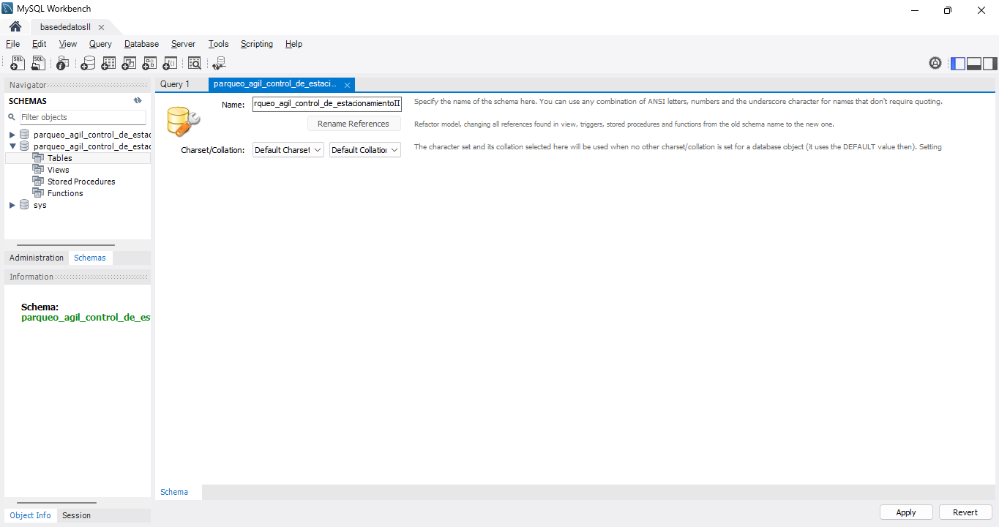
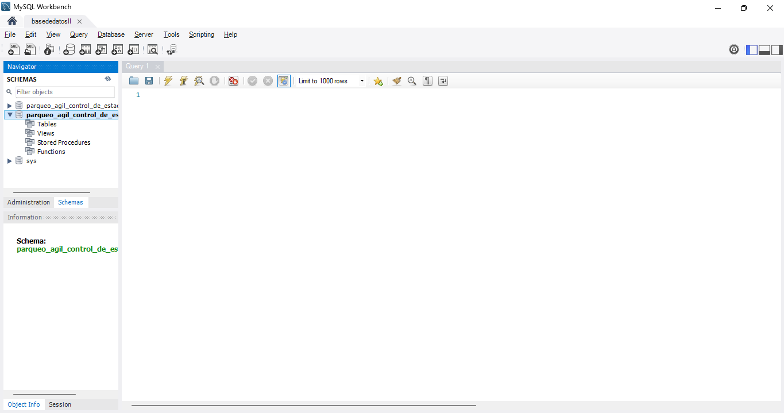
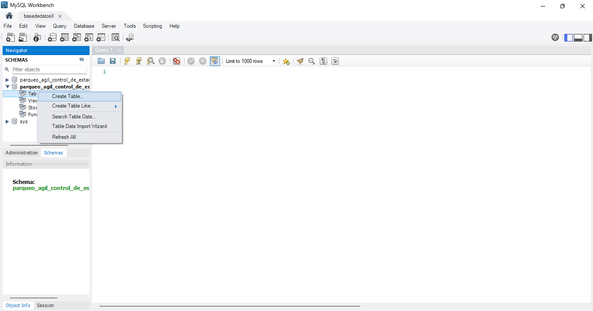
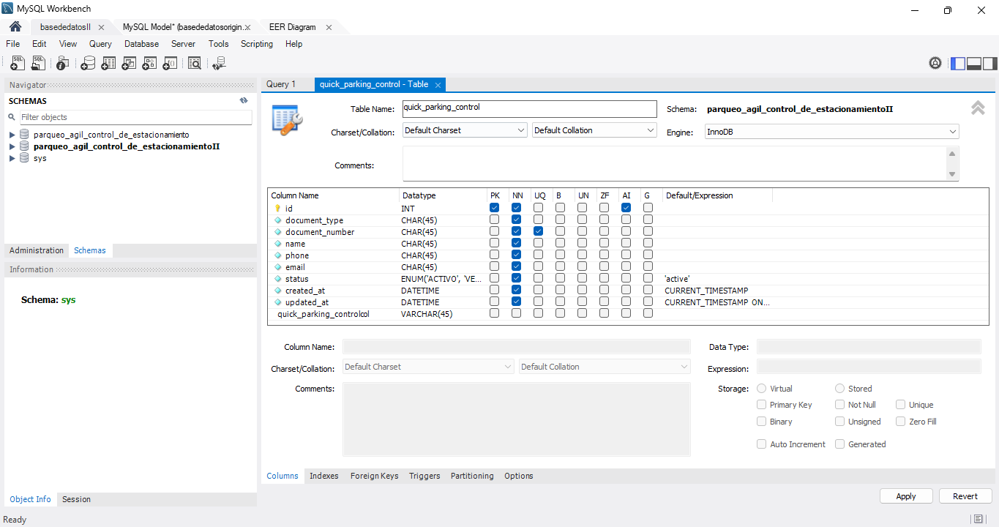
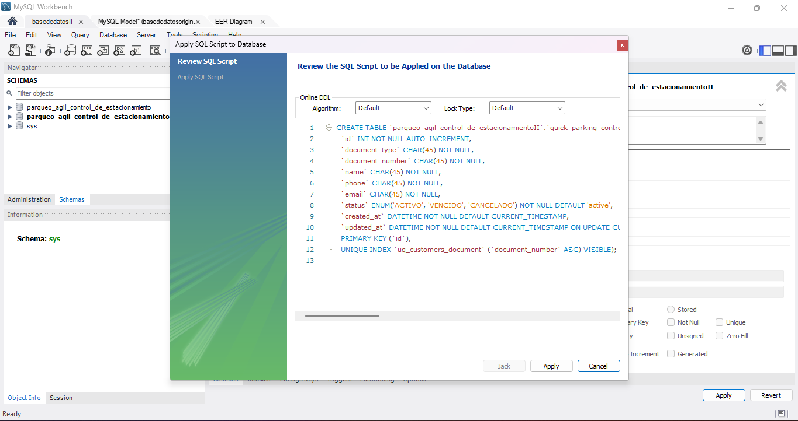

# Creación manual de tablas en MySQL Workbench

Esta guía explica cómo crear las tablas de una base de datos desde la interfaz de MySQL Workbench.

## Requisito previo

Antes de crear las tablas, prepara una base de datos independiente. Así evitas modificar por error la instalación principal. Consulta la [guía de la segunda base de datos](../../informe%20base%20de%20datos%20alvaro/guiasegundobasededatos.md).

## 1. Crear y seleccionar el esquema

1. En MySQL Workbench, crea un esquema nuevo desde **Create a new schema in the connected server**.
2. Asigna un nombre al esquema y aplica los cambios.
3. Selecciona el esquema creado en el panel **SCHEMAS**.

## 2. Crear una tabla

El siguiente ejemplo crea la tabla `quick_parking_control`:

1. Haz clic derecho en **Tables** y selecciona **Create Table**.

   

2. Escribe el nombre de la tabla y define sus campos, tipos de datos, claves y restricciones.

   

3. Revisa la sentencia generada por MySQL Workbench y selecciona **Apply**.

   

4. Selecciona **Apply** nuevamente y luego **Finish** para finalizar la creación.

   

## 3. Repetir el proceso para las demás tablas

Para cada tabla restante, repite el procedimiento anterior:

1. Haz clic derecho en **Tables** y selecciona **Create Table**.
2. Define el nombre de la tabla y sus campos.
3. Verifica la sentencia SQL generada.
4. Selecciona **Apply** y, al terminar, **Finish**.

Comprueba que cada tabla aparezca en el panel **SCHEMAS** antes de continuar con la siguiente.
