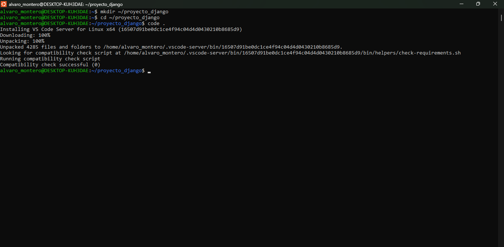
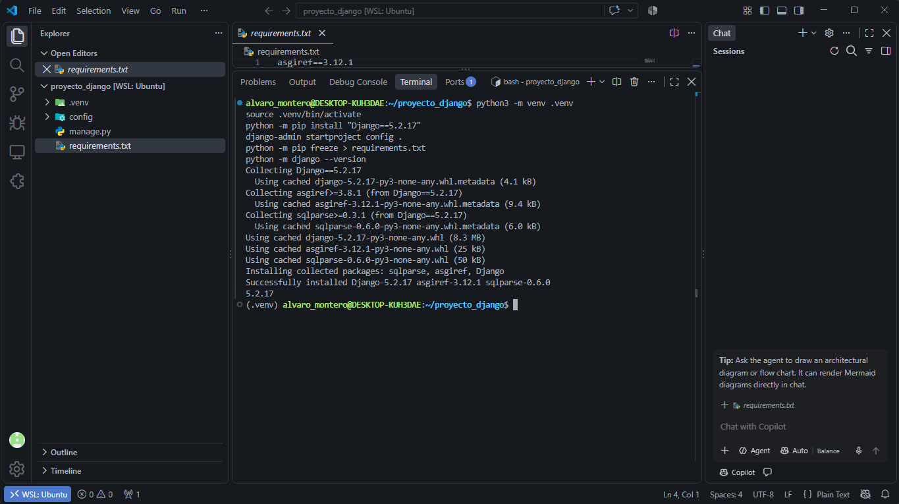
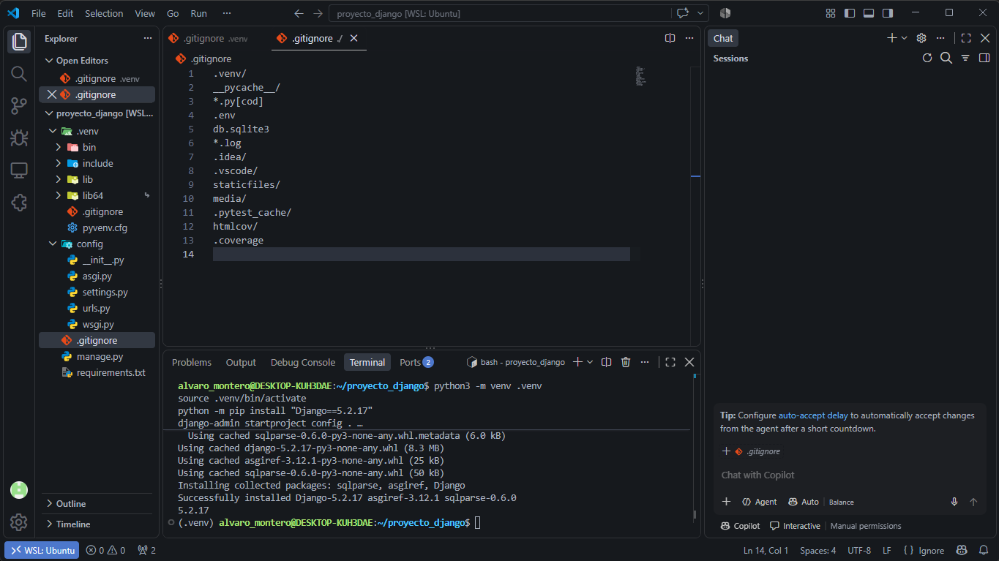
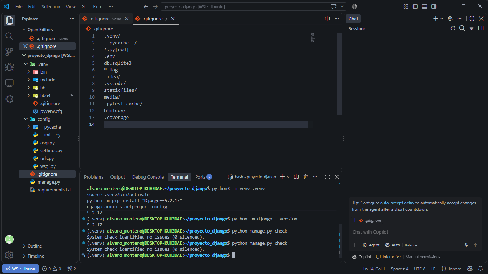
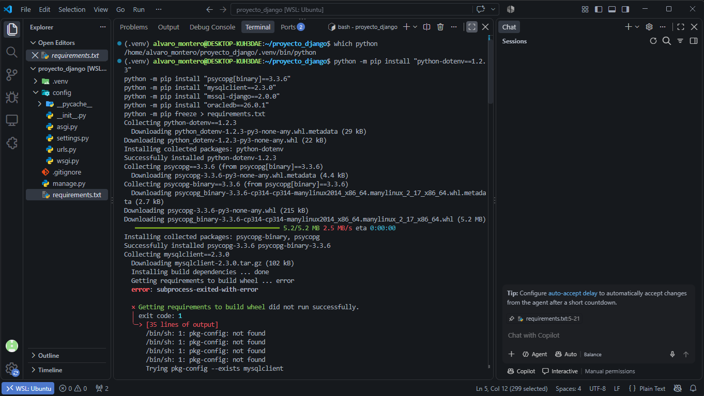
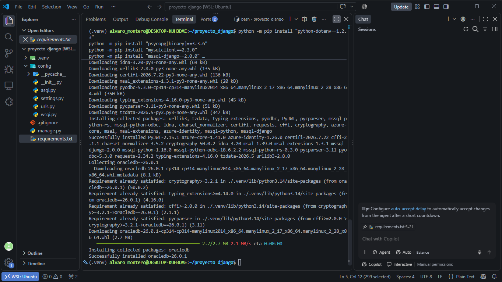

# Informe técnico del proyecto Django

---

## Universidad de La Guajira

### Facultad de Ingeniería

| Dato | Información |
| :-- | :-- |
| Programa | Ingeniería de Sistemas |
| Estudiante | Alvaro Montero |
| Asignatura | Desarrollo Web — semestre 2026-II |
| Área del proyecto | Base de Datos II |
| Docente | ING. JAIDER J. QUINTERO MENDOZA, PhD G en Innovación |
| Proyecto | ParqueoÁgil: control de estacionamiento con Django |
| Base de datos | `parqueo_agil_control_de_estacionamiento` (MySQL) |

---


## ISS-00 - Entorno y proyecto Django
 
### Paso 1: Instalar la extensión de WSL en VS Code
Abre Visual Studio Code.
Ve a la pestaña de Extensiones (el ícono de los cuadrados en la barra lateral izquierda o presiona Ctrl+Shift+X).
Busca WSL (creada por Microsoft) e instálala.
` Nota: En WSL, los proyectos funcionan mucho más rápido y dan menos errores de permisos si los guardas en el disco duro de Linux, no en el de Windows (C:\).`
Abre tu terminal de Ubuntu (búscala en el menú inicio de Windows).
Crea una carpeta para tu proyecto en el entorno Linux y entra a ella:

```bash 
mkdir ~/proyecto_django
cd ~/proyecto_django
```

Desde esa misma terminal de Ubuntu, abre VS Code escribiendo: 

```bash
code .
```

evidencia que el todo esta bien instalado 



### Paso 2 - Entorno virtual y proyecto base

Preparé un entorno virtual `.venv`, lo activé e instalé Django 5.2.17. Después creé el proyecto `config` directamente en la raíz y exporté las dependencias a `requirements.txt`.

```bash
python3 -m venv .venv
source .venv/bin/activate
python -m pip install "Django==5.2.17"
django-admin startproject config .
python -m pip freeze > requirements.txt
python -m django --version
```

**Evidencia (EVI-00-02):**


&nbsp;

**Observación:** El terminal mostró la instalación correcta de Django y la versión `5.2.17`. En el explorador de VS Code se ven `.venv/`, `config/`, `manage.py` y `requirements.txt`, es decir, la estructura inicial esperada.

**Conclusión y aprendizaje:** El entorno virtual aísla las librerías del proyecto, y `django-admin startproject config .` deja la configuración en la carpeta actual. `requirements.txt` permite reconstruir el mismo entorno en otra máquina.

### Paso 2 - Archivo `.gitignore`

En la raíz del proyecto creé `.gitignore` para que Git ignore el entorno virtual, cachés de Python, configuración local y otros archivos generados.


```gitignore
.venv/
__pycache__/
*.py[cod]
.env
db.sqlite3
*.log
.idea/
.vscode/
staticfiles/
media/
.pytest_cache/
htmlcov/
.coverage
```

**Evidencia (EVI-00-01):**



&nbsp;

**Observación:** La captura muestra el comando de creación, la ruta devuelta por `pwd` y el contenido listado con `cat`, lo que confirma que el archivo está en el lugar correcto con las reglas pedidas.

**Conclusión y aprendizaje:** `.gitignore` debe vivir en la raíz para aplicarse a todo el proyecto. Excluir `.venv/`, cachés y `.env` evita subir por error archivos locales o sensibles.

### Paso 3 - Verificación de la instalación

Confirmé la versión de Django y revisé que el proyecto inicial no tuviera problemas.

```bash
python -m django --version
python manage.py check
```

**Evidencia (EVI-00-03):**


&nbsp;

**Observación:** Salió la versión `5.2.17` y el mensaje `System check identified no issues (0 silenced)`, señal de que Django reconoce el proyecto sin errores.

**Conclusión y aprendizaje:** Con los comandos oficiales se valida tanto la versión como la configuración. Con esto el entorno queda listo para el ISS-01.

## ISS-01 - Settings y selección del motor

### Paso 1 - Instalación de dependencias

Instalé las herramientas del sistema necesarias para compilar el conector de MySQL y añadí al entorno Django, python-dotenv y los cuatro conectores de base de datos. Al final regeneré `requirements.txt`.

```bash
sudo apt update
sudo apt install build-essential pkg-config default-libmysqlclient-dev python3.12-dev

source .venv/bin/activate
python -m pip install "Django==5.2.17" "python-dotenv==1.2.3"
python -m pip install "mysqlclient==2.3.0"
python -m pip install "psycopg[binary]==3.3.6" "mssql-django==2.0.0" "oracledb==26.0.1"
python -m pip freeze > requirements.txt
```

**Evidencia (EVI-01-01):**



&nbsp;


**Observación:** `apt update` terminó bien y las herramientas de compilación ya estaban disponibles. La segunda captura muestra las dependencias de Python instaladas y el prompt con `(.venv)` activo. `requirements.txt` registra Django 5.2.17, python-dotenv 1.2.3, mysqlclient 2.3.0, psycopg 3.3.6, mssql-django 2.0.0 y oracledb 26.0.1 con sus dependencias.

**Conclusión y aprendizaje:** Algunos conectores necesitan paquetes del sistema además de los de Python. Actualizar `requirements.txt` tras instalar deja registro reproducible de las versiones.

### Paso 2 - Archivo `.env`

Creé `.env` en la raíz con la configuración de Django y las variables de conexión de los motores. El selector `DB_DIALECT` quedó en `mysql`, apuntando a la base `parqueo_agil_control_de_estacionamiento`. Este archivo queda fuera del control de versiones gracias a `.gitignore`.

```dotenv
DJANGO_SECRET_KEY=[REDACTADO]
DJANGO_DEBUG=True
DJANGO_ALLOWED_HOSTS=[VALORES_CONFIGURADOS]

DB_DIALECT=mysql
DB_MYSQL_HOST=[VALOR_CONFIGURADO]
DB_MYSQL_PORT=[VALOR_CONFIGURADO]
DB_MYSQL_USERNAME=[VALOR_CONFIGURADO]
DB_MYSQL_PASSWORD=<TU_CONTRASENA_SEGURA>
DB_MYSQL_NAME=parqueo_agil_control_de_estacionamiento

DB_POSTGRES_HOST=[VALOR_CONFIGURADO]
DB_POSTGRES_PORT=[VALOR_CONFIGURADO]
DB_POSTGRES_USERNAME=[REDACTADO]
DB_POSTGRES_PASSWORD=[REDACTADO]
DB_POSTGRES_NAME=[VALOR_CONFIGURADO]

DB_MSSQL_HOST=[VALOR_CONFIGURADO]
DB_MSSQL_PORT=[VALOR_CONFIGURADO]
DB_MSSQL_USERNAME=[REDACTADO]
DB_MSSQL_PASSWORD=[REDACTADO]
DB_MSSQL_NAME=[VALOR_CONFIGURADO]

DB_ORACLE_HOST=[VALOR_CONFIGURADO]
DB_ORACLE_PORT=[VALOR_CONFIGURADO]
DB_ORACLE_USERNAME=[REDACTADO]
DB_ORACLE_PASSWORD=[REDACTADO]
DB_ORACLE_CONNECT_STRING=[VALOR_CONFIGURADO]
```

**Evidencia (EVI-01-03):**

&nbsp;

**Observación:** En la captura se ve el bloque de configuración y el archivo `.env` en el explorador. Verifiqué que `.env` figura en `.gitignore`, así que no entra en los commits.

**Conclusión y aprendizaje:** Las variables de entorno separan la configuración del código fuente. Aun así, las contraseñas no deberían publicarse en informes: conviene censurarlas en la versión final que se entregue o se comparta.

### Paso 3 - Configuración del motor de base de datos

Creé `config/database.py`, que lee `DB_DIALECT`, valida las variables necesarias para el motor elegido y construye solo `DATABASES["default"]`. Soporta MySQL, PostgreSQL, SQL Server y Oracle según el contrato del ISS-01.

```python
import os

from django.core.exceptions import ImproperlyConfigured


def _required(name: str) -> str:
    value = os.getenv(name)
    if value is None or not value.strip():
        raise ImproperlyConfigured(f"Falta la variable de entorno requerida: {name}")
    return value.strip()


dialect = _required("DB_DIALECT").lower()

if dialect == "mysql":
    database = {
        "ENGINE": "django.db.backends.mysql",
        "NAME": _required("DB_MYSQL_NAME"),
        "USER": _required("DB_MYSQL_USERNAME"),
        "PASSWORD": _required("DB_MYSQL_PASSWORD"),
        "HOST": _required("DB_MYSQL_HOST"),
        "PORT": _required("DB_MYSQL_PORT"),
    }
elif dialect == "postgres":
    database = {
        "ENGINE": "django.db.backends.postgresql",
        "NAME": _required("DB_POSTGRES_NAME"),
        "USER": _required("DB_POSTGRES_USERNAME"),
        "PASSWORD": _required("DB_POSTGRES_PASSWORD"),
        "HOST": _required("DB_POSTGRES_HOST"),
        "PORT": _required("DB_POSTGRES_PORT"),
    }
elif dialect == "mssql":
    database = {
        "ENGINE": "mssql",
        "NAME": _required("DB_MSSQL_NAME"),
        "USER": _required("DB_MSSQL_USERNAME"),
        "PASSWORD": _required("DB_MSSQL_PASSWORD"),
        "HOST": _required("DB_MSSQL_HOST"),
        "PORT": _required("DB_MSSQL_PORT"),
    }
elif dialect == "oracle":
    database = {
        "ENGINE": "django.db.backends.oracle",
        "NAME": _required("DB_ORACLE_CONNECT_STRING"),
        "USER": _required("DB_ORACLE_USERNAME"),
        "PASSWORD": _required("DB_ORACLE_PASSWORD"),
    }
else:
    raise ImproperlyConfigured(
        "DB_DIALECT debe ser mysql, postgres, mssql u oracle"
    )

DATABASES = {"default": database}
```

**Evidencia (EVI-01-04):**

&nbsp;

**Observación:** El archivo quedó dentro de `config/`. Al revisarlo comprobé que cubre los cuatro dialectos, lanza un error claro si falta una variable y expone únicamente el alias `default`.

**Conclusión y aprendizaje:** Aislar la selección del motor del resto de la configuración facilita detectar variables faltantes y evita preparar conexiones para motores que no se usan. La integración con `settings.py` se hace en el paso siguiente.

### Paso 4 - Integración de `.env` en `settings.py`

Modifiqué `config/settings.py` para cargar `.env` al arrancar. `SECRET_KEY`, `DEBUG` y `ALLOWED_HOSTS` salen de variables de entorno y reemplacé la base SQLite por defecto con `DATABASES` importado de `config.database`.

```python
import os
from pathlib import Path

from dotenv import load_dotenv
from django.core.exceptions import ImproperlyConfigured

BASE_DIR = Path(__file__).resolve().parent.parent
load_dotenv(BASE_DIR / ".env")

secret_key = os.getenv("DJANGO_SECRET_KEY")
if not secret_key:
    raise ImproperlyConfigured("Falta la variable de entorno requerida: DJANGO_SECRET_KEY")

SECRET_KEY = secret_key
DEBUG = os.getenv("DJANGO_DEBUG", "False").strip().lower() in {"true", "1", "yes", "on"}
ALLOWED_HOSTS = [
    host.strip()
    for host in os.getenv("DJANGO_ALLOWED_HOSTS", "").split(",")
    if host.strip()
]

# En la sección Database de settings.py:
from config.database import DATABASES
```

**Evidencia (EVI-01-05):**

&nbsp;

**Evidencia (EVI-01-06):**

&nbsp;

**Evidencia (EVI-01-07):**

&nbsp;

**Evidencia (EVI-01-08):**

&nbsp;

**Observación:** `load_dotenv(BASE_DIR / ".env")` se ejecuta antes de importar `DATABASES`, de modo que `config.database` ya encuentra las variables. La clave se valida, `DEBUG` se convierte a booleano y `ALLOWED_HOSTS` se separa por comas.

**Conclusión y aprendizaje:** El orden importa: primero se cargan las variables y después se importa el módulo que las usa. Además, la clave secreta deja de estar escrita en `settings.py`.

### Paso 5 - Verificación y arranque del servidor

Ejecuté la comprobación del sistema y luego levanté el servidor de desarrollo.

```bash
python manage.py check
python manage.py runserver
```

**Evidencia (EVI-01-09):**

&nbsp;

**Evidencia (EVI-01-10):**

&nbsp;

**Observación:** `check` respondió `System check identified no issues (0 silenced)`. El servidor inició en `http://127.0.0.1:8000/`, devolvió HTTP 200 y mostró la página de bienvenida; también avisó de 18 migraciones pendientes de las apps integradas de Django.

**Conclusión y aprendizaje:** `check` valida la configuración y `runserver` confirma que la aplicación responde. No ejecutaré `python manage.py migrate` todavía, porque el esquema de ParqueoÁgil se administra con scripts SQL y no debe alterarse desde migraciones de Django. Antes de seguir detengo el servidor con Ctrl+C.

### Paso 6 - Verificación de las tablas de ParqueoÁgil

Desde DBeaver verifiqué, con una consulta de solo lectura sobre `INFORMATION_SCHEMA.TABLES`, que las 13 tablas del modelo de ParqueoÁgil existen en la base `parqueo_agil_control_de_estacionamiento`. La consulta no modifica el esquema.

```sql
SELECT esperada.table_name AS tabla,
       CASE
           WHEN existente.TABLE_NAME IS NULL THEN 'FALTA'
           ELSE 'EXISTE'
       END AS estado
FROM (
    SELECT 'roles' AS table_name
    UNION ALL SELECT 'usuarios'
    UNION ALL SELECT 'clientes'
    UNION ALL SELECT 'vehiculos'
    UNION ALL SELECT 'zonas'
    UNION ALL SELECT 'espacios'
    UNION ALL SELECT 'tarifas'
    UNION ALL SELECT 'turnos_caja'
    UNION ALL SELECT 'tickets'
    UNION ALL SELECT 'abonos'
    UNION ALL SELECT 'abono_vehiculo'
    UNION ALL SELECT 'pagos'
    UNION ALL SELECT 'novedades'
) AS esperada
LEFT JOIN INFORMATION_SCHEMA.TABLES AS existente
    ON existente.TABLE_SCHEMA = 'parqueo_agil_control_de_estacionamiento'
   AND existente.TABLE_NAME = esperada.table_name
   AND existente.TABLE_TYPE = 'BASE TABLE'
ORDER BY esperada.table_name;
```

**Evidencia (EVI-01-11):**

&nbsp;

**Observación:** El resultado en DBeaver debe listar 13 filas, todas con el estado `EXISTE`. Con ello queda confirmado el requisito previo sin ejecutar scripts de borrado ni de creación.

**Conclusión y aprendizaje:** Consultar `INFORMATION_SCHEMA` permite comprobar las tablas físicas sin tocar los datos. El requisito de esquema queda verificado para la conexión MySQL seleccionada.

**Estado del ISS-01:** Quedaron completadas las dependencias, el `.env`, la selección del motor, la integración con `settings.py`, las verificaciones `check` y `runserver`, y la comprobación de las 13 tablas.

## ISS-02 - Aplicación de clientes

> La guía del ISS-02 menciona apps `product` y `sale`, pero el dominio de ParqueoÁgil no tiene productos ni ventas. Por eso solo creo la app `client` y no agrego apps ajenas al esquema.

### Paso 1 - Creación de `apps.client`

Creé el paquete `apps`, generé la app `client` con `startapp` dentro de `apps/client` y ajusté `ClientConfig` con el nombre de paquete y la etiqueta `client`.

```bash
mkdir -p apps/client
python manage.py startapp client apps/client
mkdir -p apps
touch apps/__init__.py
```

```python
class ClientConfig(AppConfig):
    default_auto_field = "django.db.models.BigAutoField"
    name = "apps.client"
    label = "client"
```

**Evidencia (EVI-02-01):**

&nbsp;

**Evidencia (EVI-02-02):**

&nbsp;

**Observación:** Se aprecian los archivos generados por `startapp` y que `ClientConfig` usa `name = "apps.client"` y `label = "client"`.

**Conclusión y aprendizaje:** `AppConfig.name` debe indicar la ruta completa del paquete. La app aún debe registrarse en `INSTALLED_APPS`, lo que hago a continuación.

### Paso 2 - Registro de la app

Agregué la configuración de `client` al final de `INSTALLED_APPS` y volví a verificar el proyecto.

```python
INSTALLED_APPS = [
    # Aplicaciones Django integradas...
    "apps.client.apps.ClientConfig",
]
```

```bash
python manage.py check
```

**Evidencia (EVI-02-03):**

&nbsp;

**Evidencia (EVI-02-04):**

&nbsp;

**Observación:** `apps.client.apps.ClientConfig` aparece en `INSTALLED_APPS` y `check` terminó sin problemas.

**Conclusión y aprendizaje:** Crear la app no es suficiente; Django solo la carga si está registrada. Todavía no existen modelos de negocio.

**Estado del ISS-02:** La app de clientes se creó con la CLI, está registrada y supera `check`. No se crearon `product` ni `sale`.

## ISS-03 - Preparación de la app de seguridad

### Paso 1 - Creación de `apps.security`

Generé la app `security` dentro de `apps` y configuré su `AppConfig` con el nombre completo y la etiqueta `security`.

```bash
mkdir -p apps/security
python manage.py startapp security apps/security
```

```python
class SecurityConfig(AppConfig):
    default_auto_field = "django.db.models.BigAutoField"
    name = "apps.security"
    label = "security"
```

**Evidencia (EVI-03-01):**

&nbsp;

**Evidencia (EVI-03-02):**

&nbsp;

**Observación:** Se ven los archivos creados y la configuración con el nombre `apps.security`. La app aún no está en `INSTALLED_APPS` y no se ejecutó ninguna migración.

**Conclusión y aprendizaje:** Antes de declarar el modelo de usuario debo adaptarlo a la tabla `usuarios` existente en lugar de copiar el ejemplo genérico del ISS.

**Nota de revisión:** La tabla `usuarios` de ParqueoÁgil tiene `id`, `rol_id`, `nombre`, `username`, `email`, `password_hash`, `is_active`, `created_at` y `updated_at`. El ejemplo `AbstractUser` de la guía incluye campos que no corresponden a esa tabla, por lo que lo adapto en vez de usarlo literal.

### Paso 2 - Estados compartidos

Creé `apps/common/status.py` como módulo compartido, sin convertir `common` en app Django. Definí los estados `active` e `inactive` con `TextChoices`.

```python
from django.db import models


class RecordStatus(models.TextChoices):
    ACTIVE = "active", "Active"
    INACTIVE = "inactive", "Inactive"
```

**Evidencia (EVI-03-03):**

&nbsp;

**Observación:** Se creó el directorio `apps/common` con su `__init__.py` y el archivo `status.py`, que coincide con la guía.

**Conclusión y aprendizaje:** `TextChoices` centraliza los valores permitidos para reutilizarlos en varios modelos. `common` es solo un paquete Python compartido.

### Paso 3 - Modelo de usuario adaptado a ParqueoÁgil

Adapté `apps/security/models.py` para representar la tabla `usuarios`. El modelo hereda de `AbstractBaseUser`, enlaza `password` con la columna `password_hash`, y se declara `managed = False` para que Django no cree ni altere la tabla. Como las semillas guardan la clave con `SHA2(..., 256)`, el modelo reconoce ese hash heredado y, si la clave es correcta, lo reemplaza por un hash de Django.

```python
import hashlib
import string

from django.contrib.auth.base_user import AbstractBaseUser, BaseUserManager
from django.db import models
from django.utils.crypto import constant_time_compare


class UserManager(BaseUserManager):
    use_in_migrations = True

    def create_user(self, username, password=None, rol_id=None, **extra_fields):
        if not username:
            raise ValueError("El nombre de usuario es obligatorio.")
        if rol_id is None:
            raise ValueError("rol_id es obligatorio para los usuarios de ParqueoÁgil.")

        email = extra_fields.get("email")
        extra_fields["email"] = (
            self.normalize_email(email).lower() if email else None
        )

        user = self.model(
            username=username.strip(),
            rol_id=rol_id,
            **extra_fields,
        )
        user.set_password(password)
        user.save(using=self._db)
        return user


class User(AbstractBaseUser):
    id = models.AutoField(primary_key=True)
    rol_id = models.IntegerField()
    nombre = models.CharField(max_length=150)
    username = models.CharField(max_length=100, unique=True)
    password = models.CharField(max_length=255, db_column="password_hash")
    email = models.EmailField(
        max_length=150,
        unique=True,
        null=True,
        blank=True,
    )
    is_active = models.BooleanField(default=True)
    created_at = models.DateTimeField(null=True, blank=True)
    updated_at = models.DateTimeField(null=True, blank=True)

    last_login = None

    USERNAME_FIELD = "username"
    REQUIRED_FIELDS = ["rol_id", "nombre"]

    objects = UserManager()

    class Meta:
        db_table = "usuarios"
        managed = False
        ordering = ["username"]

    def check_password(self, raw_password):
        encoded_password = self.password or ""

        if len(encoded_password) == 64 and all(
            character in string.hexdigits for character in encoded_password
        ):
            legacy_hash = hashlib.sha256(
                raw_password.encode("utf-8")
            ).hexdigest()

            if not constant_time_compare(
                legacy_hash,
                encoded_password.lower(),
            ):
                return False

            self.set_password(raw_password)
            self.save(update_fields=["password"])
            return True

        return super().check_password(raw_password)

    def __str__(self):
        return self.username
```

**Evidencia (EVI-03-04):**

&nbsp;

**Evidencia (EVI-03-05):**

&nbsp;

**Observación:** El mapeo respeta las columnas de `usuarios` y evita que Django administre el esquema. Por ahora la verificación es visual: aún no ejecuté `check` ni pruebas de autenticación, ni definí `AUTH_USER_MODEL`.

**Conclusión y aprendizaje:** Un usuario personalizado debe reflejar las columnas reales de la base. Un hash SHA-256 heredado no es compatible con los hashers de Django, así que se compara de forma segura y se actualiza tras un acceso correcto. Queda pendiente la integración con los ajustes; no se ejecutarán migraciones sobre las tablas existentes.

### Paso 4 - Registro de la app y usuario personalizado

Registré `SecurityConfig` en `INSTALLED_APPS` y configuré `AUTH_USER_MODEL` para usar `security.User`.

```python
INSTALLED_APPS = [
    # ...
    "apps.client.apps.ClientConfig",
    "apps.security.apps.SecurityConfig",
]

AUTH_USER_MODEL = "security.User"
```

```bash
python manage.py check
```

```text
System check identified no issues (0 silenced).
```

**Evidencia (EVI-03-06):**

&nbsp;

**Evidencia (EVI-03-07):**

&nbsp;

**Observación:** En la revisión inicial encontré duplicados de `ClientConfig`, `SecurityConfig`, la importación de `DATABASES` y `AUTH_USER_MODEL`. Dejé una sola entrada de cada uno en `config/settings.py` y volví a ejecutar `check`, que terminó sin problemas. Las capturas muestran el estado previo a la corrección y no tengo captura de la segunda ejecución, por lo que queda documentada como texto.

**Conclusión y aprendizaje:** La app que define el usuario y `AUTH_USER_MODEL` deben coincidir desde el inicio. `check` valida la configuración, pero no sustituye las pruebas con datos reales. No ejecuté `makemigrations` ni `migrate` en este paso.

### Paso 5 - Pruebas de selección del motor

Escribí pruebas unitarias en `apps/security/tests.py` que comprueban la selección de MySQL, PostgreSQL, SQL Server y Oracle, el rechazo de un dialecto inválido, de una variable vacía y la cadena de conexión de Oracle. Las pruebas sustituyen las variables de entorno y no abren conexiones.

```python
import importlib
import os
from unittest.mock import patch

from django.core.exceptions import ImproperlyConfigured
from django.test import SimpleTestCase

import config.database as database_config


class DatabaseSelectionTests(SimpleTestCase):
    def database_environment(self, dialect):
        return {
            "DB_DIALECT": dialect,
            "DB_MYSQL_NAME": "parqueo_test",
            "DB_MYSQL_USERNAME": "test_user",
            "DB_MYSQL_PASSWORD": "test_password",
            "DB_MYSQL_HOST": "localhost",
            "DB_MYSQL_PORT": "3306",
            "DB_POSTGRES_NAME": "parqueo_test",
            "DB_POSTGRES_USERNAME": "test_user",
            "DB_POSTGRES_PASSWORD": "test_password",
            "DB_POSTGRES_HOST": "localhost",
            "DB_POSTGRES_PORT": "5432",
            "DB_MSSQL_NAME": "parqueo_test",
            "DB_MSSQL_USERNAME": "test_user",
            "DB_MSSQL_PASSWORD": "test_password",
            "DB_MSSQL_HOST": "localhost",
            "DB_MSSQL_PORT": "1433",
            "DB_ORACLE_CONNECT_STRING": "localhost:1521/PARQUEO",
            "DB_ORACLE_USERNAME": "test_user",
            "DB_ORACLE_PASSWORD": "test_password",
        }

    def load_database(self, environment):
        with patch.dict(os.environ, environment, clear=True):
            importlib.reload(database_config)
            return database_config.DATABASES["default"].copy()

    def test_each_database_dialect(self):
        expected_engines = {
            "mysql": "django.db.backends.mysql",
            "postgres": "django.db.backends.postgresql",
            "mssql": "mssql",
            "oracle": "django.db.backends.oracle",
        }

        for dialect, expected_engine in expected_engines.items():
            with self.subTest(dialect=dialect):
                database = self.load_database(
                    self.database_environment(dialect)
                )
                self.assertEqual(database["ENGINE"], expected_engine)

    def test_invalid_database_dialect(self):
        environment = {"DB_DIALECT": "sqlite"}

        with patch.dict(os.environ, environment, clear=True):
            with self.assertRaisesRegex(
                ImproperlyConfigured,
                "DB_DIALECT debe ser mysql, postgres, mssql u oracle",
            ):
                importlib.reload(database_config)

    def test_empty_required_database_variable(self):
        environment = self.database_environment("mysql")
        environment["DB_MYSQL_NAME"] = " "

        with patch.dict(os.environ, environment, clear=True):
            with self.assertRaisesRegex(
                ImproperlyConfigured,
                "DB_MYSQL_NAME",
            ):
                importlib.reload(database_config)

    def test_oracle_service_name_connection_string(self):
        environment = self.database_environment("oracle")
        database = self.load_database(environment)

        self.assertEqual(
            database["NAME"],
            "localhost:1521/PARQUEO",
        )
```

**Evidencia (EVI-03-08):**

&nbsp;

**Evidencia (EVI-03-09):**

&nbsp;

Ejecución:

```bash
python manage.py test apps.security.tests.DatabaseSelectionTests
```

```text
Found 4 test(s).
System check identified no issues (0 silenced).
Ran 4 tests in 0.006s
OK
```

**Evidencia (EVI-03-10):**

&nbsp;

**Observación:** Las cuatro pruebas pasaron y Django no reportó problemas de configuración. Usan valores ficticios, por lo que no dependen de que haya servidores de base de datos activos.

**Conclusión y aprendizaje:** Aislar las variables de entorno en cada caso permite probar todas las ramas del selector y sus errores sin conectarse a las tablas reales. No se ejecutaron migraciones.

### Paso 6 - Simulación de la migración del usuario

Antes de generar o aplicar nada, usé el modo de simulación:

```bash
python manage.py makemigrations security --dry-run --verbosity 3
```

La salida mostró una operación `CreateModel` para `User` con `managed = False` sobre la tabla `usuarios`. Al ser `--dry-run`, no se escribió `0001_initial.py` ni se tocó la base de datos.

**Evidencia (EVI-03-11):**

&nbsp;

**Observación:** Django prepara el estado del modelo y conserva que `usuarios` no es administrada por él. Sin embargo, esto no prueba que todas las migraciones del proyecto sean inocuas: las de `auth`, `contenttypes`, `admin` y `sessions` pueden crear sus propias tablas al aplicarse, por lo que aún no ejecuto `migrate`.

**Conclusión y aprendizaje:** `--dry-run` permite revisar la migración propuesta sin guardarla. Una migración de estado para un modelo `managed = False` no autoriza a aplicar todas las migraciones del proyecto.

### Paso 7 - Generación de la migración inicial del usuario

Tras revisar la simulación, generé el archivo real:

```bash
python manage.py makemigrations security
```

Django creó `apps/security/migrations/0001_initial.py` con el estado de `User`. Verifiqué que mantiene `managed = False` y el nombre de tabla `usuarios`. Se generó el archivo, pero no se ejecutó ni se modificó la base de datos.

**Evidencia (EVI-03-12):**

&nbsp;

**Observación:** El terminal muestra el mensaje `Create model User` y el archivo creado.

**Conclusión y aprendizaje:** `makemigrations` solo produce el archivo de estado; no aplica cambios. Antes de `migrate` debo revisar qué tablas crearían las migraciones integradas de Django.

### Paso 8 - Revisión del plan de migraciones

Inspeccioné las operaciones pendientes:

```bash
python manage.py migrate --plan
```

El plan incluyó `security.0001_initial` y operaciones de `contenttypes`, `admin`, `auth` y `sessions`. El comando solo muestra el plan; no aplicó nada.

**Evidencia (EVI-03-13):**

&nbsp;

**Observación:** Aplicar `migrate` afectaría más que el modelo de usuario, pues también procesaría las migraciones integradas de Django. La captura no muestra el SQL de cada operación, así que lo revisaré antes de decidir si es compatible con el esquema.

**Conclusión y aprendizaje:** Revisar el plan permite saber qué apps intervienen antes de aplicar cambios.

### Paso 9 - Aplicación de las migraciones

Ejecuté el comando indicado por el ISS:

```bash
python manage.py migrate
```

La terminal marcó como aplicadas `security.0001_initial` y las migraciones de `contenttypes`, `admin`, `auth` y `sessions`.

**Evidencia (EVI-03-14):**

&nbsp;

**Observación:** Cada migración pendiente terminó en `OK`. La de `security` conserva `managed = False` para `usuarios`; las apps integradas de Django registraron sus propias migraciones.

**Conclusión y aprendizaje:** Aplicar el plan y verificar su resultado en el terminal confirma que las migraciones pendientes se completaron sin error.

### Paso 10 - Pruebas posteriores a la migración

Volví a ejecutar la suite tras migrar:

```bash
python manage.py test apps.security.tests.DatabaseSelectionTests
```

```text
Found 4 test(s).
System check identified no issues (0 silenced).
Ran 4 tests in 0.009s
OK
```

**Evidencia (EVI-03-15):**

&nbsp;

**Observación:** Las cuatro pruebas siguen pasando después de migrar.

**Conclusión y aprendizaje:** Repetir las pruebas tras aplicar migraciones confirma que la configuración sigue funcionando. Este resultado valida la selección de motores, pero todavía no cubre el flujo de autenticación de ParqueoÁgil.

### Paso 11 - Verificación final del ISS-03

```bash
python manage.py check
```

```text
System check identified no issues (0 silenced).
```

**Evidencia (EVI-03-16):**

&nbsp;

**Observación:** La comprobación terminó sin errores.

**Conclusión y aprendizaje:** Cerrar el ISS con `check` confirma que el proyecto sigue sin problemas reportados.

## ISS-04 - Modelo Cliente de ParqueoÁgil

### Paso 1 - Mapeo del modelo Client

Definí `Client` sobre la tabla física `clientes`, con los campos `tipo_documento`, `numero_documento`, `nombre`, `telefono`, `email`, `is_active`, `created_at` y `updated_at`. Lo marqué `managed = False` porque el esquema se mantiene con los scripts SQL del proyecto.

```python
from django.db import models


class Client(models.Model):
    id = models.AutoField(primary_key=True)
    tipo_documento = models.CharField(max_length=20)
    numero_documento = models.CharField(max_length=30, unique=True)
    nombre = models.CharField(max_length=150)
    telefono = models.CharField(max_length=30, null=True, blank=True)
    email = models.EmailField(max_length=150, null=True, blank=True)
    is_active = models.BooleanField(default=True)
    created_at = models.DateTimeField(null=True, blank=True)
    updated_at = models.DateTimeField(null=True, blank=True)

    class Meta:
        db_table = "clientes"
        managed = False

    def __str__(self):
        return f"{self.nombre} ({self.numero_documento})"
```

**Evidencia (EVI-04-01):**

&nbsp;

**Observación:** Contrasté el modelo con la definición SQL de `clientes`; nombres y longitudes coinciden. No incluye contraseña ni vínculo con usuarios, porque la tabla no los tiene. `check` terminó con `System check identified no issues (0 silenced)`.

**Conclusión y aprendizaje:** Se puede mapear un perfil de cliente a una tabla existente sin duplicar datos ni modificar el esquema físico.

### Paso 2 - Migración de estado

```bash
python manage.py makemigrations client
```

Django informó `Create model Client` y generó `apps/client/migrations/0001_initial.py`, con `db_table = "clientes"` y `managed = False`.

**Evidencia (EVI-04-02):**

&nbsp;

**Observación:** El archivo registra el estado del modelo sin crear ni administrar la tabla física.

**Conclusión y aprendizaje:** `managed = False` distingue la representación del modelo en Django de la creación real de la tabla.

### Paso 3 - Aplicación de la migración

```bash
python manage.py migrate
```

Django mostró `Applying client.0001_initial... OK`.

**Evidencia (EVI-04-03):**

&nbsp;

**Observación:** Al ser `managed = False`, solo se registra el estado; la tabla `clientes` no se crea ni se modifica.

**Conclusión y aprendizaje:** Se confirma la aplicación de la migración leyendo la salida de Django.

### Paso 4 - Verificación del ISS-04

```bash
python manage.py check
```

```text
System check identified no issues (0 silenced).
```

**Evidencia (EVI-04-04):**

&nbsp;

**Observación:** No hay errores tras registrar el modelo y aplicar su migración.

**Conclusión y aprendizaje:** Conviene volver a verificar el proyecto después de cada migración.

### Paso 5 - Pruebas disponibles de Client

```bash
python manage.py test apps.client
```

```text
Found 0 test(s).
System check identified no issues (0 silenced).
Ran 0 tests in 0.000s
NO TESTS RAN
```

**Evidencia (EVI-04-05):**

&nbsp;

**Observación:** El comando no reportó problemas, pero tampoco había pruebas, por lo que no lo registro como pruebas aprobadas.

**Conclusión y aprendizaje:** Ejecutar el test runner sin casos de prueba no implica cobertura. Las pruebas HTTP del CRUD se escriben después de construir la API.

## ISS-05 - Catálogo de ParqueoÁgil

### Paso 1 - App `catalog`

Creé la app `catalog` dentro de `apps`, definí su nombre y etiqueta y la registré en `INSTALLED_APPS`.

```bash
mkdir -p apps/catalog
python manage.py startapp catalog apps/catalog
```

```python
class CatalogConfig(AppConfig):
    default_auto_field = "django.db.models.BigAutoField"
    name = "apps.catalog"
    label = "catalog"
```

```python
"apps.catalog.apps.CatalogConfig",
```

**Evidencia (EVI-05-01):**

&nbsp;

**Observación:** Se ve la estructura generada y la actualización de `INSTALLED_APPS`, con `name = "apps.catalog"` y `label = "catalog"`.

**Conclusión y aprendizaje:** Las apps bajo `apps/` deben registrarse con su ruta Python completa.

### Paso 2 - Modelos del catálogo

Definí `Zone`, `Space`, `Rate` y `Vehicle` con las tablas `zonas`, `espacios`, `tarifas` y `vehiculos`, todos con `managed = False`.

```python
from django.db import models


class Zone(models.Model):
    id = models.AutoField(primary_key=True)
    nombre = models.CharField(max_length=100)
    descripcion = models.CharField(max_length=255, null=True, blank=True)
    is_active = models.BooleanField(default=True)
    created_at = models.DateTimeField(null=True, blank=True)
    updated_at = models.DateTimeField(null=True, blank=True)

    class Meta:
        db_table = "zonas"
        managed = False

    def __str__(self):
        return self.nombre


class Space(models.Model):
    id = models.AutoField(primary_key=True)
    zona = models.ForeignKey(
        Zone,
        on_delete=models.DO_NOTHING,
        db_column="zona_id",
        related_name="espacios",
    )
    nombre = models.CharField(max_length=50)
    descripcion = models.CharField(max_length=255, null=True, blank=True)
    is_active = models.BooleanField(default=True)
    created_at = models.DateTimeField(null=True, blank=True)
    updated_at = models.DateTimeField(null=True, blank=True)

    class Meta:
        db_table = "espacios"
        managed = False
        constraints = [
            models.UniqueConstraint(
                fields=("zona", "nombre"),
                name="uq_espacios_nombre_zona",
            ),
        ]

    def __str__(self):
        return self.nombre


class Rate(models.Model):
    class Rule(models.TextChoices):
        POR_HORA = "POR_HORA"
        POR_FRACCION = "POR_FRACCION"
        TARIFA_PLANA = "TARIFA_PLANA"

    id = models.AutoField(primary_key=True)
    nombre = models.CharField(max_length=100)
    regla_calculo = models.CharField(max_length=20, choices=Rule.choices)
    valor_base = models.DecimalField(max_digits=10, decimal_places=2)
    vigencia_desde = models.DateField()
    vigencia_hasta = models.DateField(null=True, blank=True)
    is_active = models.BooleanField(default=True)
    created_at = models.DateTimeField(null=True, blank=True)
    updated_at = models.DateTimeField(null=True, blank=True)

    class Meta:
        db_table = "tarifas"
        managed = False

    def __str__(self):
        return self.nombre


class Vehicle(models.Model):
    id = models.AutoField(primary_key=True)
    cliente = models.ForeignKey(
        "client.Client",
        on_delete=models.DO_NOTHING,
        db_column="cliente_id",
        null=True,
        blank=True,
        related_name="vehiculos",
    )
    placa = models.CharField(max_length=15, unique=True)
    nombre = models.CharField(max_length=150, null=True, blank=True)
    descripcion = models.CharField(max_length=255, null=True, blank=True)
    is_active = models.BooleanField(default=True)
    created_at = models.DateTimeField(null=True, blank=True)
    updated_at = models.DateTimeField(null=True, blank=True)

    class Meta:
        db_table = "vehiculos"
        managed = False

    def __str__(self):
        return self.placa
```

**Evidencia (EVI-05-02):**

&nbsp;

**Observación:** Revisé el archivo completo contra el SQL de las tablas y `check` terminó con `System check identified no issues (0 silenced)`. Los modelos describen el catálogo real de zonas, espacios, tarifas y vehículos.

**Conclusión y aprendizaje:** `db_table`, `db_column` y `managed = False` permiten representar entidades que ya existen, conservando la relación de cada espacio con su zona.

### Paso 3 - Migración inicial

```bash
python manage.py makemigrations catalog
```

Django creó los modelos `Rate`, `Space`, `Vehicle` y `Zone` en `apps/catalog/migrations/0001_initial.py`, cada uno con su tabla física y `managed = False`.

**Evidencia (EVI-05-03):**

&nbsp;

**Observación:** La salida confirma la generación para los cuatro modelos, sin aplicarla aún a la base de datos.

**Conclusión y aprendizaje:** La migración solo registra el estado de los modelos; las tablas siguen bajo los scripts SQL.

### Paso 4 - Aplicación de la migración

```bash
python manage.py migrate
```

Django mostró `Applying catalog.0001_initial... OK`.

**Evidencia (EVI-05-04):**

&nbsp;

**Observación:** La migración quedó registrada en el historial de Django, sin administrar las tablas existentes.

**Conclusión y aprendizaje:** Se confirma en el terminal la aplicación de la migración de estado del catálogo.

### Paso 5 - Verificación

```bash
python manage.py check
```

```text
System check identified no issues (0 silenced).
```

**Evidencia (EVI-05-05):**

&nbsp;

**Observación:** Sin problemas tras registrar y migrar el catálogo.

**Conclusión y aprendizaje:** Verificar al cerrar la unidad de modelos evita arrastrar errores al siguiente ISS.

## ISS-06 - Operación de tickets de ParqueoÁgil

### Paso 1 - App `parking`

Creé la carpeta `apps/parking`, generé la app y la registré en `INSTALLED_APPS` como `apps.parking.apps.ParkingConfig`.

**Evidencia (EVI-06-01):**

&nbsp;

**Observación:** `apps/parking` aparece en el explorador y el terminal volvió al prompt sin errores.

**Conclusión y aprendizaje:** `startapp` requiere que la carpeta de destino exista cuando la app se crea dentro de `apps/`.

### Paso 2 - Modelos de la operación

En `apps/parking/models.py` creé `CashShift` (`turnos_caja`), `Ticket` (`tickets`), `Payment` (`pagos`) y `Incident` (`novedades`), relacionados con los modelos de clientes y catálogo. Todos apuntan a su tabla física y declaran `managed = False`.

**Evidencia (EVI-06-02):**

&nbsp;

**Evidencia (EVI-06-03):**

&nbsp;

**Evidencia (EVI-06-04):**

&nbsp;

```bash
python manage.py check
```

```text
System check identified no issues (0 silenced).
```

**Observación:** Las relaciones con vehículos, espacios, tarifas y turnos de caja y los nombres de tabla son los del esquema físico. Django no reportó problemas.

**Conclusión y aprendizaje:** La operación de estacionamiento se representa sin dejar que Django administre la creación de las tablas.

### Paso 3 - Migración de estado

```bash
python manage.py makemigrations parking
```

Django creó `apps/parking/migrations/0001_initial.py` para `CashShift`, `Incident`, `Payment` y `Ticket`, todos con `managed = False`.

**Evidencia (EVI-06-05):**

&nbsp;

**Observación:** El terminal confirma la generación del archivo con los cuatro modelos.

**Conclusión y aprendizaje:** Se genera la migración de estado conservando `managed = False` para proteger las tablas del esquema SQL.

### Paso 4 - Aplicación de la migración

```bash
python manage.py migrate parking
```

Django informó `Applying parking.0001_initial... OK`.

**Evidencia (EVI-06-06):**

&nbsp;

**Observación:** La migración quedó registrada sin errores y las tablas siguen bajo el esquema SQL.

**Conclusión y aprendizaje:** Se aplica y verifica la migración de estado sin ceder a Django la administración de las tablas.

### Paso 5 - Verificación final

```bash
python manage.py check
```

```text
System check identified no issues (0 silenced).
```

**Evidencia (EVI-06-07):**

&nbsp;

**Observación:** Sin problemas tras registrar los modelos de la operación.

**Conclusión y aprendizaje:** Cerrar el ISS con `check` confirma que la app `parking` y sus modelos están bien registrados.

## ISS-07 - REST Framework, CORS y JSON camelCase

### Paso 1 - Dependencias de la API

```bash
source .venv/bin/activate
python -m pip install "djangorestframework==3.17.2" "djangorestframework-camel-case==1.4.2" "django-cors-headers==4.9.0"
python -m pip freeze > requirements.txt
```

**Evidencia (EVI-07-01):**

&nbsp;

**Observación:** Se instalaron las tres dependencias y `requirements.txt` ya incluye sus versiones.

**Conclusión y aprendizaje:** Las dependencias se instalan y se registran antes de configurar apps, middleware y renderers.

### Paso 2 - REST Framework y CORS

Registré `rest_framework` y `corsheaders` en `INSTALLED_APPS`, puse `CorsMiddleware` antes del middleware de seguridad y configuré `CORS_ALLOW_ALL_ORIGINS` desde la variable de entorno del mismo nombre.

**Evidencia (EVI-07-02):**

&nbsp;

**Observación:** En `settings.py` se ven las aplicaciones y el middleware de CORS.

**Conclusión y aprendizaje:** El control de orígenes queda en una variable de entorno, no escrito en el código.

### Paso 3 - Renderer y parser camelCase

Configuré permisos `AllowAny` por defecto, renderers y parsers camelCase y la paginación desactivada, conforme al ISS-07.

**Evidencia (EVI-07-03):**

&nbsp;

**Observación:** La configuración hace que el contrato HTTP use camelCase sin cambiar los nombres de campos de los modelos Python.

**Conclusión y aprendizaje:** La conversión camelCase se resuelve en la capa HTTP, manteniendo snake_case en los modelos.

### Paso 4 - Verificación

```bash
python manage.py check
```

```text
System check identified no issues (0 silenced).
```

**Evidencia (EVI-07-04):**

&nbsp;

**Observación:** Django no encontró problemas con DRF y CORS.

**Conclusión y aprendizaje:** Conviene comprobar los ajustes tras integrar apps, middleware y renderers.

### Paso 5 - Serializers

Creé `ClientSerializer`; `ZoneSerializer`, `SpaceSerializer`, `RateSerializer` y `VehicleSerializer` para el catálogo; y `TicketSerializer`, `CashShiftSerializer`, `PaymentSerializer` e `IncidentSerializer` para la operación. Conservé los campos reales del esquema y marqué como solo lectura los identificadores y las fechas generadas.

**Evidencia (EVI-07-05):**

&nbsp;

```bash
python manage.py check
```

**Observación:** Los archivos `serializers.py` existen en las apps de cliente, catálogo y operación, y `check` salió sin problemas.

**Conclusión y aprendizaje:** Los modelos se traducen a serializers sin cambiar los nombres del esquema físico.

### Paso 6 - Salida camelCase

Comprobé que `TicketSerializer` expone el campo Python `hora_ingreso` y que el renderer lo convierte a camelCase en el JSON.

```json
{"horaIngreso": "2026-10-12T12:00:00Z", "montoCalculado": "0.00"}
Serializer de ticket y JSON camelCase: OK
```

**Evidencia (EVI-07-06):**

&nbsp;

**Observación:** El JSON muestra `horaIngreso` y `montoCalculado`, mientras que el serializer conserva los nombres en snake_case.

**Conclusión y aprendizaje:** La conversión se verifica en la salida HTTP sin renombrar campos del modelo ni del serializer.

## ISS-08 - Clientes con ModelViewSet

### Paso 1 - ClientViewSet

Creé `ClientViewSet` con `ModelViewSet`, `ClientSerializer` y permiso `AllowAny`. Como la tabla `clientes` ya tiene `is_active`, la baja lógica se hace actualizando ese campo; por eso no habilité `DELETE`.

**Evidencia (EVI-08-01):**

&nbsp;

**Observación:** El archivo muestra el queryset, el serializer, el permiso y los métodos HTTP sin `DELETE`. `check` salió con `System check identified no issues (0 silenced)`.

**Conclusión y aprendizaje:** Se adapta el ViewSet al esquema real y se evita borrar clientes que tengan vehículos o abonos asociados.

### Paso 2 - Rutas de clientes

Registré `ClientViewSet` con `SimpleRouter` y conecté el router bajo `/api/`.

**Evidencia (EVI-08-02):**

&nbsp;

**Observación:** Se ve el router de la app `client`, su inclusión en `/api/` y `check` sin problemas.

**Conclusión y aprendizaje:** El prefijo general de la API se define en el proyecto y las rutas específicas en cada aplicación.

### Paso 3 - Pruebas de rutas

Agregué pruebas que verifican la resolución de rutas de colección y detalle y las acciones HTTP disponibles, sin consultar la base de datos.

```bash
python manage.py test apps.client
```

**Evidencia (EVI-08-03):**

&nbsp;

**Observación:** El terminal muestra `Found 2 test(s)` y `OK`; se validaron listado, creación, detalle, actualización completa y parcial, y que `DELETE` no está habilitado.

**Conclusión y aprendizaje:** Las rutas y métodos se pueden probar sin acceder a la base de datos.

### Paso 4 - Serializer y camelCase

Verifiqué `ClientSerializer` con un objeto en memoria, comprobando que expone los campos de la tabla y que `numero_documento` pasa a `numeroDocumento`.

```json
{"id": 1, "tipoDocumento": "CC", "numeroDocumento": "DOC-001", "nombre": "Ana Ruiz", "telefono": null, "email": null, "isActive": true, "createdAt": null, "updatedAt": null}
ClientSerializer y JSON camelCase: OK
```

**Evidencia (EVI-08-04):**

&nbsp;

**Observación:** La terminal confirma los campos en camelCase y el mensaje `ClientSerializer y JSON camelCase: OK`.

**Conclusión y aprendizaje:** El serializer respeta el perfil real de `clientes` y camelCase solo se aplica al JSON serializado.

### Paso 5 - Métodos HTTP

Con el cliente de API de Django comprobé que la colección expone GET y POST y el detalle GET, PUT y PATCH, y que `DELETE` devuelve `405 Method Not Allowed`.

**Evidencia (EVI-08-05):**

&nbsp;

**Observación:** La terminal confirma `DELETE responde 405 Method Not Allowed: OK`.

**Conclusión y aprendizaje:** Se valida el comportamiento HTTP del ViewSet y que no se pueden borrar clientes desde el endpoint.

### Paso 6 - Lectura de la colección

Consulté `GET /api/clients/` en modo de solo lectura. Respondió HTTP 200 con una lista JSON y campos camelCase; no mostré ni registré datos personales.

**Evidencia (EVI-08-06):**

&nbsp;

**Observación:** La terminal confirma `GET /api/clients/: HTTP 200` y la estructura esperada.

**Conclusión y aprendizaje:** Se puede validar un endpoint con consultas de solo lectura sin divulgar datos personales.

### Paso 7 - Lectura por identificador

Tomé el identificador del primer resultado y consulté su detalle. Respondió HTTP 200 con los campos camelCase y sin imprimir valores personales.

**Evidencia (EVI-08-08):**

&nbsp;

**Observación:** La terminal confirma `GET /api/clients/<id>/: HTTP 200`.

**Conclusión y aprendizaje:** Se verifica el detalle con un registro existente manteniendo los datos personales fuera de la salida.

### Paso 8 - Solicitud incompleta

Envié un POST con cuerpo vacío para comprobar la validación sin crear clientes:

```text
POST /api/clients/ con cuerpo vacío: HTTP 400
Validación del cuerpo sin crear registros: OK
```

**Evidencia (EVI-08-07):**

&nbsp;

**Observación:** El `400 Bad Request` confirma que el serializer rechaza un cuerpo sin los campos obligatorios y no se insertó nada.

**Conclusión y aprendizaje:** Una solicitud incompleta es una forma segura de validar antes de probar una creación válida.

### Paso 9 - CRUD en base aislada

Probé POST, GET de detalle y PATCH con una base SQLite en memoria y tablas temporales:

```text
POST en SQLite en memoria: HTTP 201
GET de detalle: HTTP 200
PATCH en SQLite en memoria: HTTP 200
DELETE: HTTP 405
MySQL no fue utilizado ni modificado.
```

**Evidencia (EVI-08-09):**

&nbsp;

**Observación:** Se confirma la creación y actualización en la base temporal, la lectura del detalle y el rechazo de DELETE, sin usar la conexión MySQL.

**Conclusión y aprendizaje:** Las escrituras se prueban en una base desechable para mantener intactos los datos reales de ParqueoÁgil.

### Paso 10 - Verificación final del ISS-08

```bash
python manage.py check
python manage.py test apps.client
```

**Evidencia (EVI-08-10):**

&nbsp;

**Observación:** `System check identified no issues (0 silenced)` y `Ran 2 tests` con `OK`.

**Conclusión y aprendizaje:** La unidad se cierra con la revisión general y las pruebas automatizadas de rutas, separadas de las pruebas de escritura aisladas.

## ISS-09 - Catálogo con ModelViewSet

### Paso 1 - ViewSets del catálogo

Creé los ViewSets de zonas, espacios, tarifas y vehículos con `ModelViewSet`, sus serializers y permiso `AllowAny`. Deshabilité `DELETE` para proteger registros que están vinculados con tickets.

**Evidencia (EVI-09-01):**

&nbsp;

```bash
python manage.py check
```

**Observación:** Los cuatro ViewSets se basan en los modelos reales y `check` informó `System check identified no issues (0 silenced)`.

**Conclusión y aprendizaje:** Se publican los recursos reales del catálogo y se protegen sus relaciones evitando el borrado desde la API.

### Paso 2 - Rutas del catálogo

Registré las rutas de zonas, espacios, tarifas y vehículos con `SimpleRouter` y las conecté bajo `/api/`.

**Evidencia (EVI-09-02):**

&nbsp;

**Observación:** `apps.catalog.urls` está incluido en las rutas del proyecto y `check` salió sin errores.

**Conclusión y aprendizaje:** Las rutas específicas viven en su app y se incluyen en el prefijo común de la API.

### Paso 3 - Verificación de rutas

Comprobé las rutas de colección y detalle de los cuatro recursos sin consultar la base de datos.

**Evidencia (EVI-09-03):**

&nbsp;

**Observación:** Se confirman las cuatro parejas de rutas y que `DELETE` no está habilitado; no se accedió a MySQL.

**Conclusión y aprendizaje:** Conviene validar la resolución y los métodos de cada recurso antes de consultar la base.

### Paso 4 - Pruebas de rutas

```bash
python manage.py test apps.catalog
```

**Evidencia (EVI-09-04):**

&nbsp;

**Observación:** El terminal muestra `Found 2 test(s)` y `OK`, con la comprobación del sistema sin problemas.

**Conclusión y aprendizaje:** Las pruebas rápidas y aisladas confirman el enrutamiento sin depender de la base de datos.

### Paso 5 - Verificación final

```bash
python manage.py check
```

**Evidencia (EVI-09-05):**

&nbsp;

**Observación:** Django no detectó problemas tras registrar ViewSets y rutas del catálogo.

**Conclusión y aprendizaje:** Se cierra la unidad verificando los ajustes generales.

## ISS-10 - Espacios disponibles

### Paso 1 - Endpoint de disponibilidad

Agregué `AvailableSpaceListAPIView` con `ListAPIView` y la ruta de lectura `GET /api/spaces/available/`. El queryset devuelve los espacios activos que no tienen un ticket abierto, igual que la vista `vw_espacios_disponibles` del esquema.

**Evidencia (EVI-10-01):**

&nbsp;

**Evidencia (EVI-10-02):**

&nbsp;

```bash
python manage.py check
```

**Observación:** El filtro de disponibilidad y la ruta quedaron registrados antes del router del catálogo, y `check` terminó sin problemas.

**Conclusión y aprendizaje:** Una lectura especializada con `ListAPIView` se separa del CRUD y se ajusta a espacios, zonas y tickets reales.

### Paso 2 - Verificación del filtro

Probé `GET /api/spaces/available/` con datos temporales en SQLite en memoria. Respondió HTTP 200 y devolvió únicamente los espacios activos sin ticket abierto; quedaron excluidos un espacio inactivo y otro con un ticket en estado `ABIERTO`. MySQL no fue utilizado ni modificado.

**Evidencia (EVI-10-03):**

&nbsp;

**Evidencia (EVI-10-04):**

&nbsp;

**Evidencia (EVI-10-05):**

&nbsp;

**Observación:** El endpoint incluyó solo los espacios que cumplían todas las condiciones.

**Conclusión y aprendizaje:** Los filtros relacionados entre espacios y tickets se prueban con datos aislados para no escribir en la base MySQL del proyecto.

## ISS-11 - Registro de ingreso con APIView

### Paso 1 - Manager transaccional

Creé `TicketQuerySet.register_entry()` y lo conecté al modelo `Ticket` mediante `TicketManager`. En una sola transacción valida el vehículo, el espacio, la tarifa y el turno de caja abierto, y registra el ticket con su hora de ingreso en estado `ABIERTO`. Los modelos conservan `managed = False`.

**Evidencia (EVI-11-01):**

&nbsp;

**Evidencia (EVI-11-02):**

&nbsp;

**Observación:** `check` terminó bien y desde el shell de Django verifiqué que `Ticket.objects` expone `register_entry`.

**Conclusión y aprendizaje:** Centralizar las reglas del ingreso en un manager y agrupar los cambios en una transacción mantiene coherentes el ticket y la ocupación del espacio.

### Paso 2 - Serializer de entrada

Agregué `TicketEntrySerializer` sin reemplazar los existentes, con los campos de vehículo, espacio, tarifa y turno de caja, y conecté su creación con `Ticket.objects.register_entry()`.

**Evidencia (EVI-11-03):**

&nbsp;

**Observación:** Los cuatro campos aparecen en las solicitudes HTTP como `vehiculoId`, `espacioId`, `tarifaId` y `turnoCajaId`.

**Conclusión y aprendizaje:** La validación de estructura queda separada de las reglas transaccionales.

### Paso 3 - APIView y ruta

Agregué `TicketEntryAPIView` para procesar el POST, validar el cuerpo con `TicketEntrySerializer` y responder con `TicketSerializer`. Registré `/api/tickets/` en las rutas del proyecto.

**Evidencia (EVI-11-04):**

&nbsp;

**Observación:** La ruta `api/tickets/` se resuelve a la vista esperada y `check` no reportó problemas.

**Conclusión y aprendizaje:** Una operación de negocio se conecta a una `APIView` con ruta propia, dejando la lógica en el serializer y el manager.

### Paso 4 - Pruebas transaccionales

Probé el endpoint con datos temporales en SQLite en memoria. El ingreso válido respondió HTTP 201, creó el ticket `ABIERTO` con monto inicial nulo y ocupó el espacio. Los casos de espacio ocupado, tarifa inactiva, vehículo inactivo y turno de caja cerrado respondieron HTTP 400 sin dejar cambios parciales. MySQL no fue utilizado ni modificado.

**Evidencia (EVI-11-05):**

&nbsp;

**Observación:** Los casos válidos e inválidos dieron los resultados esperados y los rechazados no dejaron tickets parciales.

**Conclusión y aprendizaje:** Una operación transaccional se verifica con escenarios de éxito y rechazo, aislando los datos de prueba.

### Paso 5 - Pruebas persistentes

Agregué pruebas automatizadas del ingreso correcto y de los casos de espacio ocupado, tarifa inactiva, vehículo inactivo, turno cerrado y espacio inexistente. Las ejecuté con una base temporal SQLite; todas pasaron y Django destruyó la base al terminar. MySQL no fue utilizado ni modificado.

**Evidencia (EVI-11-06):**

&nbsp;

**Evidencia (EVI-11-07):**

&nbsp;

**Evidencia (EVI-11-08):**

&nbsp;

**Evidencia (EVI-11-09):**

&nbsp;

**Evidencia (EVI-11-10):**

&nbsp;

**Observación:** Todas las pruebas terminaron correctamente, incluido el alta con sus actualizaciones y los rechazos HTTP 400 sin cambios parciales.

**Conclusión y aprendizaje:** Se dejan pruebas repetibles para la operación y sus reglas, en una base aislada que no afecta los datos reales.

### Cierre del ISS-11

Verifiqué los criterios de aceptación: el ingreso válido responde HTTP 201 con ticket `ABIERTO`; los casos no válidos responden HTTP 400 sin cambios parciales; las pruebas automatizadas finalizaron bien y los modelos siguen mapeados a las tablas existentes con `managed = False`. Las migraciones que aparecen en la salida de las pruebas se aplicaron en la base temporal SQLite, que se destruyó al finalizar; MySQL no fue utilizado ni modificado.

## ISS-12 - Consulta y cierre de tickets

### Paso 1 - Colección y detalle de tickets

Agregué la lectura de `GET /api/tickets/` y `GET /api/tickets/<id>/`. El serializer de lectura incluye las novedades relacionadas y las consultas cargan sus relaciones sin crear ni modificar registros. Añadí pruebas que verifican que la colección incluya un ticket registrado y que el detalle muestre sus novedades.

**Evidencia (EVI-12-01):**

&nbsp;

**Observación:** Las pruebas del registro y las nuevas consultas pasaron en SQLite en memoria, que se destruyó al terminar. MySQL no fue utilizado ni modificado.

**Conclusión y aprendizaje:** Las lecturas de colección y detalle con relaciones se exponen con serializers de solo lectura, separadas de la operación de ingreso.

### Paso 2 - Cierre de ticket sin alterar el historial

Agregué `POST /api/tickets/<id>/close/` para registrar la salida de un ticket `ABIERTO`: guarda `hora_salida`, calcula `monto_calculado` según la tarifa y cambia el estado a `CERRADO`. Repetir el cierre de un ticket ya cerrado responde HTTP 409 y no cambia el registro, en concordancia con el trigger `trg_tickets_no_doble_cierre` del esquema. Ejecuté las pruebas de la suite en SQLite en memoria y todas pasaron.

**Evidencia (EVI-12-02):**

&nbsp;

**Evidencia (EVI-12-03):**

&nbsp;

**Evidencia (EVI-12-04):**

&nbsp;

**Observación:** El cierre conserva la fila y su historial, un ticket cerrado permanece sin cambios y las pruebas de ingreso y cierre terminaron correctamente.

**Conclusión y aprendizaje:** La trazabilidad de los tickets se mantiene cerrándolos mediante un cambio de estado transaccional, en lugar de eliminarlos o reescribir su salida.

## ISS-13 - Django Admin de ParqueoÁgil

### Paso 1 - Usuarios en solo lectura

Registré `User` en Django Admin para consultar usuarios, filtrar por estado y buscar por nombre de usuario o correo. Dejé deshabilitadas las acciones de alta, edición y eliminación. `check` no encontró problemas y no se modificó la base de datos.

**Evidencia (EVI-13-01):**

&nbsp;

**Evidencia (EVI-13-02):**

&nbsp;

**Observación:** El modelo `User` queda en modo de solo lectura y el proyecto supera la comprobación.

**Conclusión y aprendizaje:** Los usuarios existentes se presentan como registros consultables, sin habilitar escritura desde el Admin.

### Paso 2 - Clientes

Registré `Client` para mostrar tipo y número de documento, nombre y contacto, con búsqueda por nombre, documento o correo. Dejé como solo lectura el identificador y las fechas.

**Evidencia (EVI-13-03):**

&nbsp;

**Observación:** `ClientAdmin` está en `apps/client/admin.py` y `check` terminó bien.

**Conclusión y aprendizaje:** Se configura la visualización y la búsqueda de clientes en el panel administrativo.

### Paso 3 - Zonas

Registré `Zone` con nombre, descripción, estado y fechas, filtro por estado y búsqueda por nombre.

**Evidencia (EVI-13-04):**

&nbsp;

**Observación:** `ZoneAdmin` está en `apps/catalog/admin.py` y `check` terminó sin problemas.

**Conclusión y aprendizaje:** Se prepara una consulta de zonas con filtros y campos de identificación protegidos.

### Paso 4 - Espacios

Registré `Space` para consultar nombre, zona y estado, con filtros por estado y zona, búsqueda por nombre o zona y carga anticipada de la relación con `Zone`. El identificador queda en solo lectura.

**Evidencia (EVI-13-05):**

&nbsp;

**Observación:** `ZoneAdmin` y `SpaceAdmin` están configurados y `check` salió sin problemas.

**Conclusión y aprendizaje:** Los espacios se presentan junto con su zona y se facilita su consulta con filtros y búsqueda.

### Paso 5 - Vehículos

Registré `Vehicle` para mostrar placa, nombre, cliente y estado, con filtros por estado, búsqueda por placa y orden alfabético por placa. Identificador y fechas en solo lectura.

**Evidencia (EVI-13-06):**

&nbsp;

**Observación:** Los registros administrativos de zonas, espacios y vehículos están en `apps/catalog/admin.py` y `check` salió sin problemas.

**Conclusión y aprendizaje:** El inventario de vehículos se consulta desde el Admin con filtros y búsqueda por placa.

### Paso 6 - Tarifas

Registré `Rate` para mostrar nombre, regla de cálculo, valor base, vigencia y estado, con filtros por estado y regla, y búsqueda por nombre.

**Evidencia (EVI-13-07):**

&nbsp;

**Observación:** Las configuraciones de zonas, espacios, vehículos y tarifas están en `apps/catalog/admin.py` y `check` terminó bien.

**Conclusión y aprendizaje:** Las tarifas se consultan por regla de cálculo y estado desde Django Admin.

### Paso 7 - Tickets protegidos

Registré `Ticket` para consultar placa, espacio, tarifa, turno, horas de ingreso y salida, estado y monto, con filtros y búsqueda. Todos los campos quedan en solo lectura y están deshabilitadas las acciones de alta, edición y eliminación, para conservar en la API las reglas de negocio.

**Evidencia (EVI-13-08):**

&nbsp;

**Observación:** `TicketAdmin` no permite escritura y el proyecto supera `check`.

**Conclusión y aprendizaje:** Los tickets se exponen solo para consulta, evitando cambios desde el Admin que deban gestionarse por las operaciones de negocio.

### Paso 8 - Turnos de caja y pagos

Registré `CashShift` y `Payment` para consultar usuario, fechas, montos, método y estado. Quedan en solo lectura, con carga anticipada de las relaciones y las acciones de escritura deshabilitadas.

**Evidencia (EVI-13-09):**

&nbsp;

**Observación:** Se ven los administradores de turnos y pagos con permisos de consulta y `check` sin problemas.

**Conclusión y aprendizaje:** Los movimientos de caja se consultan en el Admin sin exponer operaciones que deben mantenerse bajo control transaccional.

### Paso 9 - Novedades

Registré `Incident` (`novedades`) para consultar el ticket, el usuario, el nombre y la descripción, con búsqueda por placa del ticket y nombre. Todos los campos en solo lectura y sin altas, ediciones ni borrados.

**Evidencia (EVI-13-10):**

&nbsp;

**Observación:** `IncidentAdmin` carga las relaciones por adelantado y `check` terminó sin problemas.

**Conclusión y aprendizaje:** El historial de novedades se conserva ofreciendo una vista administrativa sin permitir alterarlo.

### Paso 10 - Revisión visual de la entrada al Admin

Inicié el servidor de desarrollo y abrí `/admin/`. Django muestra la pantalla de inicio de sesión y la ruta responde. No pude revisar los modelos dentro del panel porque no se autenticó una cuenta autorizada, por lo que el GATE visual del ISS-13 aún no se da por cerrado.

**Evidencia (EVI-13-12):**

&nbsp;

**Observación:** Se ve la página de inicio de sesión de Django Admin y, en el terminal, el arranque correcto del servidor.

**Conclusión y aprendizaje:** Que `/admin/` abra no basta para validar los modelos; falta resolver el acceso administrativo autorizado sin exponer ni modificar credenciales o datos.
