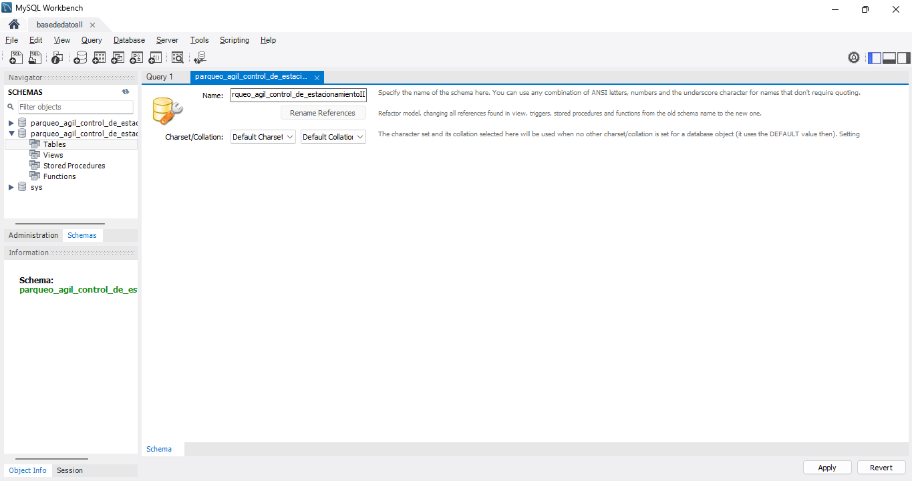
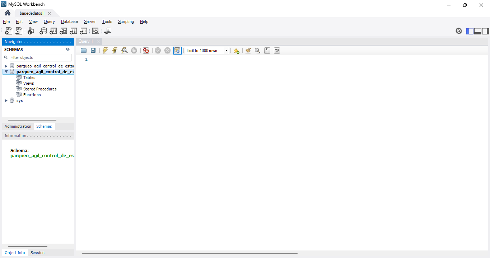
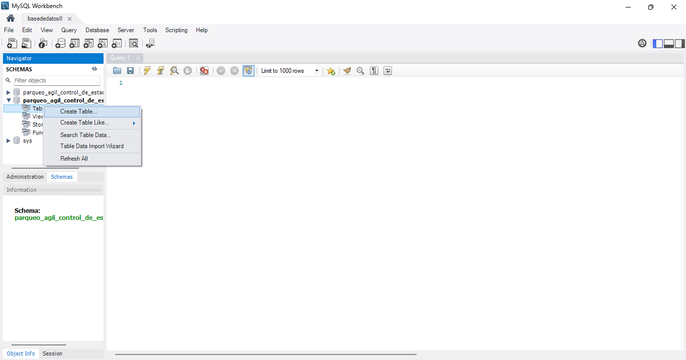
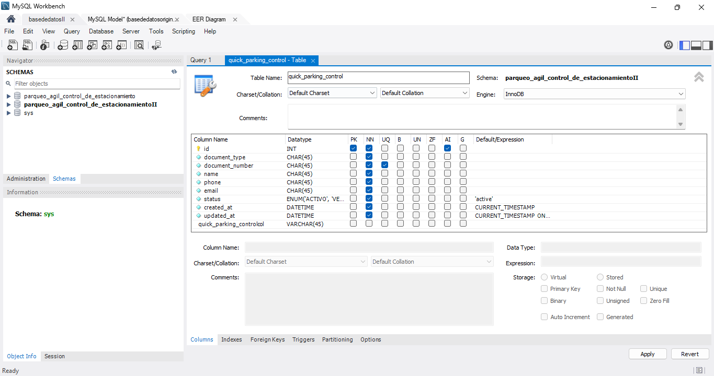
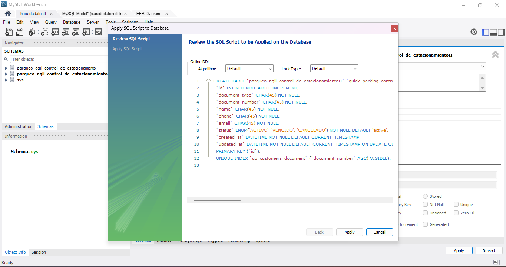

# COMO AGREGAR LA TABLAS MANUALMENTE EN LA BASE DE DATOS 

## primero creamos una base de datos independiente de la ya existe para no equivocarnos 

eso esta espesificado en esta guia 

[guía de segunda base de datos independiente](../02-instalacion-secundaria/segunda-instalacion.md).

## creamos la base de datos desde el mismo workbeach 

le damos click en create new schema in coneccted server.

con la base de datos creada comenxamos a crear las tablas 

### creacion de la primera tabla `quick_parking_control`

despues de crear la segunda base de datos nos vamos a workbech 

despues le datos click derecho a table y le damos crear table 

despues de que creamos nuestra tabla agragando el nombre de la tabla y sus campos 

luego le doy aplicar y ya la tabla esta creada 

despues en aplicar y por ultimo en finalizar 

ya nuestra primera tabla esta creada y hacermos esto con todas las demas 

### creacion de la tabla 2 `abonos`

 le damos click derecho a table y le damos en crear table 

despues creamos nuestra tabla agragando el nombre de la tabla y sus campos 

luego le doy aplicar y ya la tabla esta creada 

despues en aplicar y por ultimo en finalizar 

ya nuestra primera tabla esta creada 

### creacion de la tabla 2 `abonos`

 le damos click derecho a table y le damos en crear table 

despues creamos nuestra tabla agragando el nombre de la tabla y sus campos 

luego le doy aplicar y ya la tabla esta creada 

despues en aplicar y por ultimo en finalizar 

ya nuestra primera tabla esta creada 

### creacion de la tabla 2 `abonos`

 le damos click derecho a table y le damos en crear table 

despues creamos nuestra tabla agragando el nombre de la tabla y sus campos 

luego le doy aplicar y ya la tabla esta creada 

despues en aplicar y por ultimo en finalizar 

ya nuestra primera tabla esta creada 

### creacion de la tabla 2 `abonos`

 le damos click derecho a table y le damos en crear table 

despues creamos nuestra tabla agragando el nombre de la tabla y sus campos 

luego le doy aplicar y ya la tabla esta creada 

despues en aplicar y por ultimo en finalizar 

ya nuestra primera tabla esta creada 

### creacion de la tabla 2 `abonos`

 le damos click derecho a table y le damos en crear table 

despues creamos nuestra tabla agragando el nombre de la tabla y sus campos 

luego le doy aplicar y ya la tabla esta creada 

despues en aplicar y por ultimo en finalizar 

ya nuestra primera tabla esta creada 

### creacion de la tabla 2 `abonos`

 le damos click derecho a table y le damos en crear table 

despues creamos nuestra tabla agragando el nombre de la tabla y sus campos 

luego le doy aplicar y ya la tabla esta creada 

despues en aplicar y por ultimo en finalizar 

ya nuestra primera tabla esta creada 

### creacion de la tabla 2 `abonos`

 le damos click derecho a table y le damos en crear table 

despues creamos nuestra tabla agragando el nombre de la tabla y sus campos 

luego le doy aplicar y ya la tabla esta creada 

despues en aplicar y por ultimo en finalizar 

ya nuestra primera tabla esta creada 

### creacion de la tabla 2 `abonos`

 le damos click derecho a table y le damos en crear table 

despues creamos nuestra tabla agragando el nombre de la tabla y sus campos 

luego le doy aplicar y ya la tabla esta creada 

despues en aplicar y por ultimo en finalizar 

ya nuestra primera tabla esta creada 

### creacion de la tabla 2 `abonos`

 le damos click derecho a table y le damos en crear table 

despues creamos nuestra tabla agragando el nombre de la tabla y sus campos 

luego le doy aplicar y ya la tabla esta creada 

despues en aplicar y por ultimo en finalizar 

ya nuestra primera tabla esta creada 

### creacion de la tabla 2 `abonos`

 le damos click derecho a table y le damos en crear table 

despues creamos nuestra tabla agragando el nombre de la tabla y sus campos 

luego le doy aplicar y ya la tabla esta creada 

despues en aplicar y por ultimo en finalizar 

ya nuestra primera tabla esta creada 

### creacion de la tabla 2 `abonos`

 le damos click derecho a table y le damos en crear table 

despues creamos nuestra tabla agragando el nombre de la tabla y sus campos 

luego le doy aplicar y ya la tabla esta creada 

despues en aplicar y por ultimo en finalizar 

ya nuestra primera tabla esta creada 

### creacion de la tabla 2 `abonos`

 le damos click derecho a table y le damos en crear table 

despues creamos nuestra tabla agragando el nombre de la tabla y sus campos 

luego le doy aplicar y ya la tabla esta creada 

despues en aplicar y por ultimo en finalizar 

ya nuestra primera tabla esta creada 

